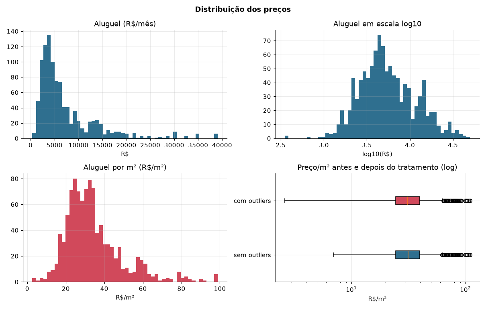
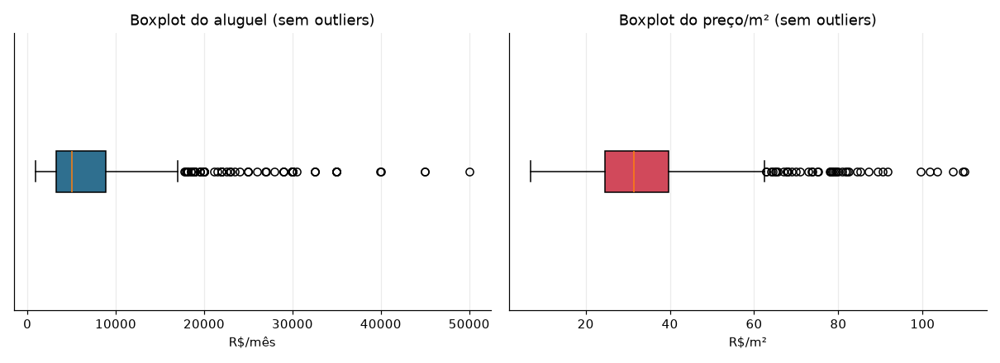
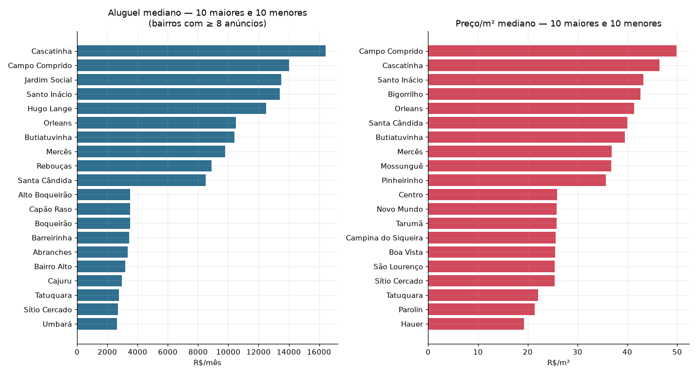
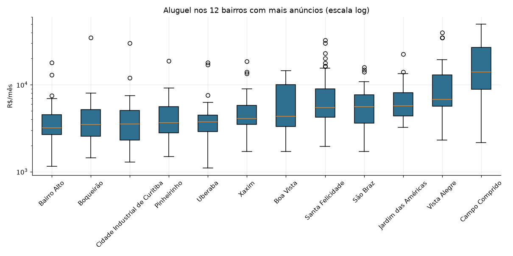
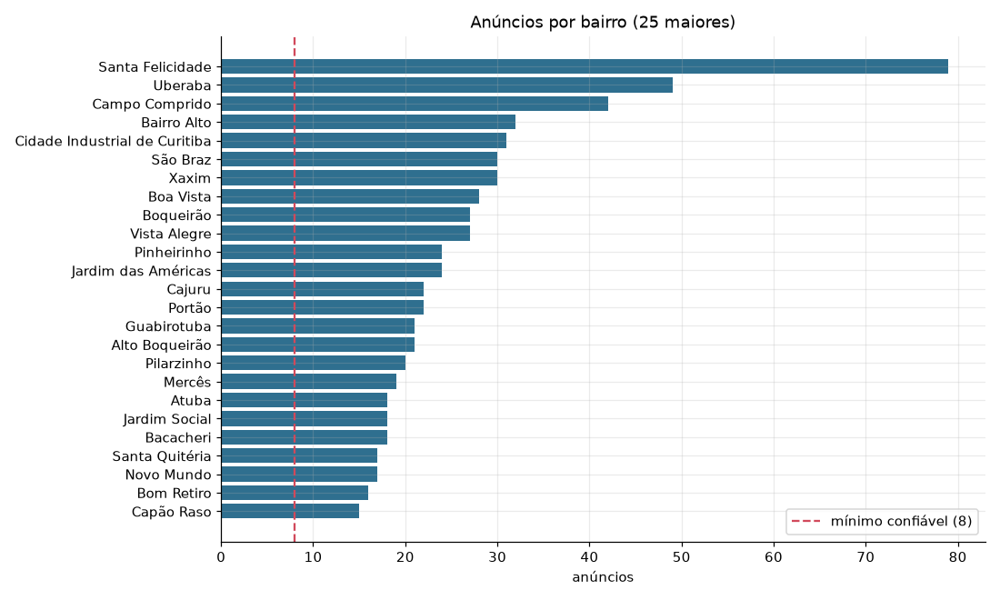
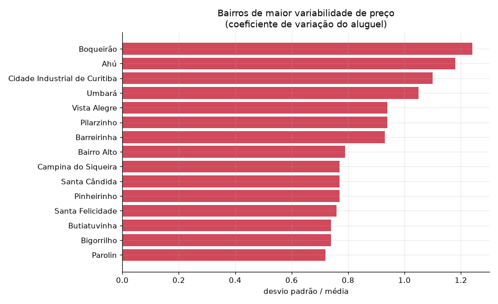
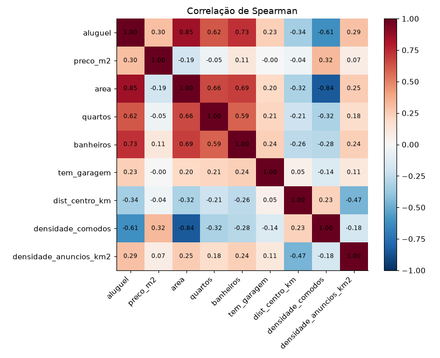
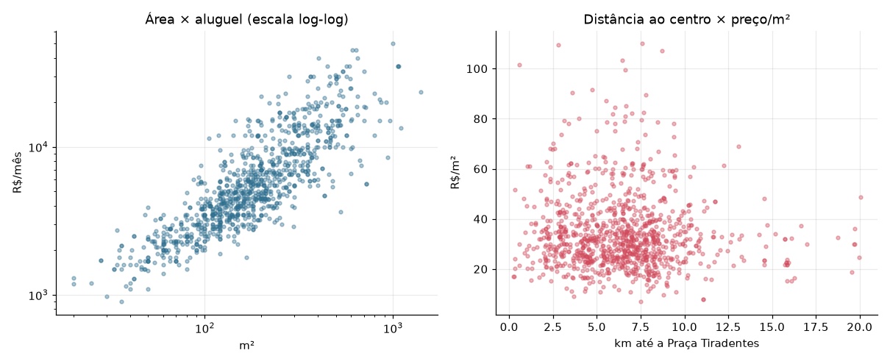
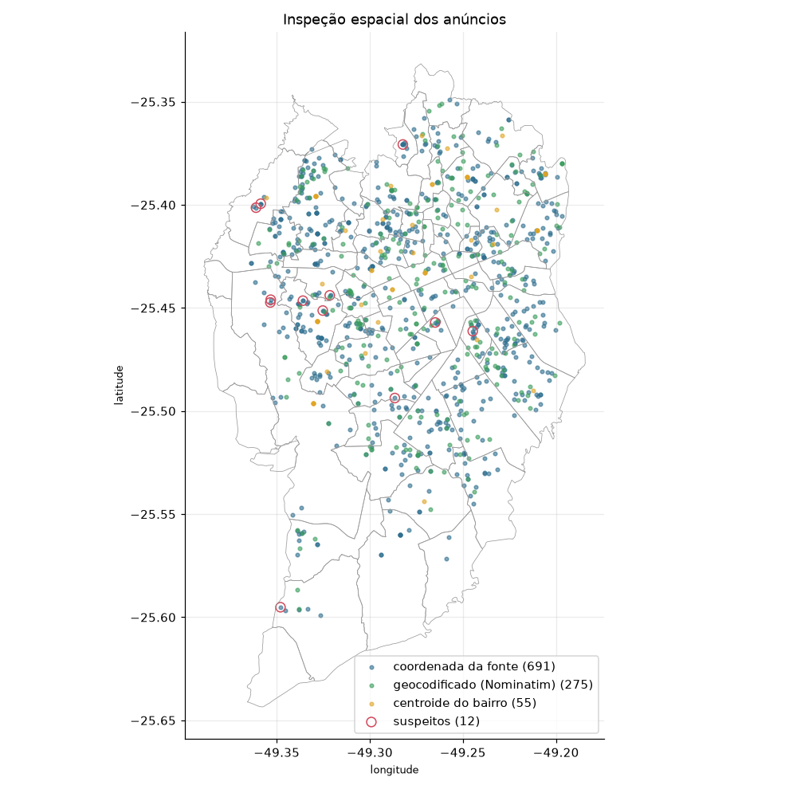
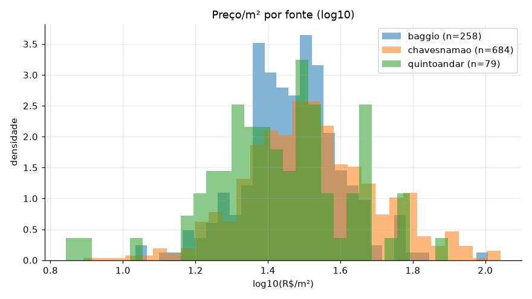

# Análise exploratória

Base: **1034** casas de locação em Curitiba após a limpeza, das quais
**1021** seguem para a modelagem (13 marcadas como outlier: `quartos_dominio` (4), `banheiros_dominio` (4), `preco_m2_iqr` (4), `preco_m2_dominio` (3), `aluguel_dominio` (2), `condominio_iptu_dominio` (1), `area_dominio` (1)).

| Fonte | Anúncios | Aluguel mediano | R$/m² mediano | Área mediana |
| :--- | ---: | ---: | ---: | ---: |
| baggio | 258 | R$ 3.800 | 29.6 | 140 m² |
| chavesnamao | 684 | R$ 5.605 | 32.3 | 185 m² |
| quintoandar | 79 | R$ 5.870 | 27.5 | 275 m² |

## Perguntas de negócio

**Qual o nível geral de preços?** Aluguel mediano de **R$ 4.995** e
**R$ 31.4/m²**. A distribuição do aluguel é assimétrica à direita (cauda de casas
de alto padrão), por isso a modelagem trabalha em escala logarítmica.

**Quais os bairros mais caros e mais baratos?** (apenas bairros com ≥ 8 anúncios)

Maior aluguel mediano:
- **Cascatinha** — R$ 16.425 (9 anúncios)
- **Campo Comprido** — R$ 14.000 (42 anúncios)
- **Jardim Social** — R$ 13.500 (18 anúncios)
- **Santo Inácio** — R$ 13.400 (8 anúncios)
- **Hugo Lange** — R$ 12.500 (10 anúncios)

Menor aluguel mediano:
- **Umbará** — R$ 2.650 (8 anúncios)
- **Sítio Cercado** — R$ 2.700 (10 anúncios)
- **Tatuquara** — R$ 2.770 (12 anúncios)
- **Cajuru** — R$ 2.975 (22 anúncios)
- **Bairro Alto** — R$ 3.200 (32 anúncios)

Maior preço/m²:
- **Campo Comprido** — R$ 49.9/m² (42 anúncios)
- **Cascatinha** — R$ 46.4/m² (9 anúncios)
- **Santo Inácio** — R$ 43.2/m² (8 anúncios)
- **Bigorrilho** — R$ 42.6/m² (12 anúncios)
- **Orleans** — R$ 41.3/m² (8 anúncios)

**Onde há mais anúncios?** 70 bairros têm ao menos um anúncio, mas só
51 passam de 8. Os demais (19) aparecem no mapa com aviso de
poucos dados: Alto da Glória, Alto da Rua XV, Batel, Cabral, Cachoeira, Campo de Santana, Centro Cívico, Cristo Rei, Fanny, Ganchinho, Guaíra, Jardim Botânico, Juvevê, Lindóia, Prado Velho, Seminário, São João, Taboão, Vila Izabel.

**Onde o preço varia mais?** Bairros com maior coeficiente de variação do aluguel — a mediana do bairro diz pouco ali:
- **Boqueirão** — CV 1.24 (27 anúncios)
- **Ahú** — CV 1.18 (8 anúncios)
- **Cidade Industrial de Curitiba** — CV 1.10 (31 anúncios)
- **Umbará** — CV 1.05 (8 anúncios)
- **Vista Alegre** — CV 0.94 (27 anúncios)

**O que se relaciona com o preço?** A área é o fator mais forte (Spearman com aluguel:
**0.85**); a distância ao centro tem correlação
**-0.04** com o preço/m².

## Qualidade espacial

80 anúncios caem em um bairro diferente do declarado (os limites do OpenStreetMap e os nomes
usados pelos portais nem sempre coincidem); 12 estão a mais de 1 km do bairro declarado e foram listados em
`reports/pontos_suspeitos.csv` para conferência. A figura mostra a origem de cada coordenada.

## Fontes

As fontes têm perfis diferentes (a tabela do início mostra aluguel e área medianos distintos entre elas), o que justifica
manter `fonte` rastreável e olhar a divergência entre portais antes de tirar conclusões por bairro.
